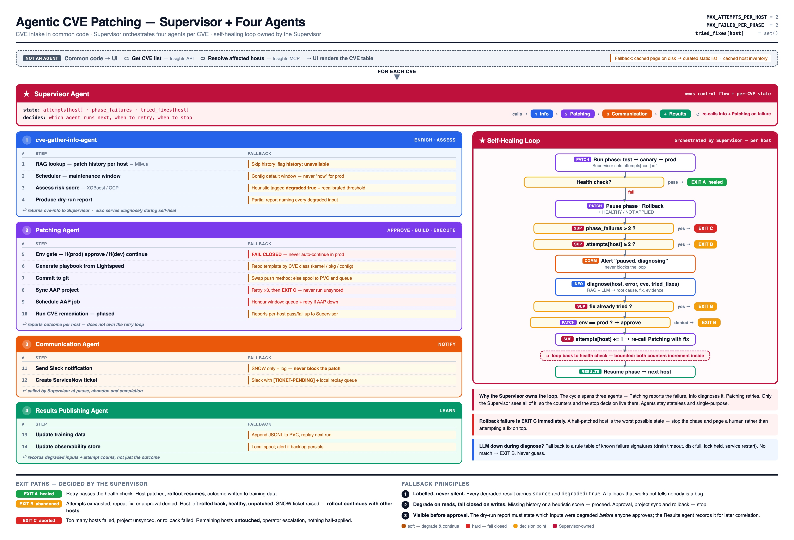

# Agentic CVE Patching

A **Supervisor agent** orchestrating specialist agents per CVE: a console UI, an
XGBoost risk model on OpenShift, a Milvus + Llama Stack RAG store, and
remediation executed by an Ansible Orchestrator workflow.

> **New here?** Start with **[QUICKSTART.md](QUICKSTART.md)** — clone to running
> in about a minute, no cluster and no credentials, with a walkthrough of both
> demo CVEs.

```bash
./demo.sh            # staged data, no network          → see Demo mode
./demo.sh --live     # real endpoints, no fallback      → see Live mode
```

Both open <http://127.0.0.1:8788>.

## Contents

| | |
|---|---|
| [Architecture](#architecture) | The agents, what is built, what lives in Ansible Orchestrator |
| [Demo mode](#demo-mode) | Run it with nothing installed. What is staged, what is not real |
| [Live mode](#live-mode) | Prerequisites, one-command setup, running against real infrastructure |
| [Using the console](#using-the-console) | The flow, the left panel, the settings panel, the CLI |
| [Configuration](#configuration) | Every switch, and where it is set |
| [ROI report](#roi-report) | What is measured, what is assumed, and how the two are kept apart |
| [The learning loop](#the-learning-loop) | Agent 4 — feeding outcomes back to RAG and the model |
| [Design notes](#design-notes) | The decisions worth knowing before changing anything |
| [Deferred and known gaps](#deferred-and-known-gaps) | Differences from the diagram, by decision and by defect |
| [Repository layout](#repository-layout) | Where everything lives |

## Architecture



Common code pulls the CVE list and its affected hosts from Insights. For each
CVE, the **Supervisor** owns the control flow and the per-CVE state, and calls
four specialist agents in turn. The agents are stateless.

| | Agent | Does | State |
|---|---|---|---|
| — | Common code *(not an agent)* | CVE list and affected hosts | Done — Insights REST |
| 1 | cve-gather-info-agent | RAG history · scheduler · risk · patch plan | Done |
| 2 | Patching Agent | Triggers the AO workflow per host, approve/reject | Done |
| 3 | Communication Agent | PDF status report | Done as scoped — Slack/SNOW deferred |
| 4 | Results Agent | RAG record + risk-model training row | Done |

Steps 5–10 of the diagram (env gate, playbook, git, AAP sync, schedule,
remediation) are **not** in this repo. They are an Ansible Orchestrator
workflow; agent 2 is a client of it, resolved by name from
`AO_WORKFLOW_NAME`.

The workflow in use is `RHEL CVE Remediation - Intelligent Patching - Demo
Jam`, derived from the lab's own: the AI triage agent is removed, because
the console's risk score already decides the route, and a verification step
is added after each remediation. A copy is committed at
[`ao-setup/demojam_lab_workflow.json`](ao-setup/demojam_lab_workflow.json).

---

## Demo mode

The default. Shows the entire flow with no cluster, no `.env` and no network.

```bash
./demo.sh
```

**No endpoint is contacted** — not attempted and timed out, but never dialled.
Demo mode skips the reachability probe entirely and opens no socket, so the
flow cannot be slowed down or broken by a backend being down.

### What you get

Every step serves stored defaults from one file,
[`fallbacks.py`](fallbacks.py):

| Step | Real backend | Staged instead |
|---|---|---|
| C1 CVE list | Insights | 2 real CVEs with real CVSS |
| C2 affected hosts | Insights | 5 hosts for CVE-2024-3094, 2 for CVE-2024-1086 |
| 1 patch history | Llama Stack / Milvus | Canned per-host summaries |
| 3 risk score | XGBoost on OpenShift | Heuristic, gated at 55 rather than the model's 30 — the two are not on the same scale |
| 5–10 remediation | Ansible Orchestrator | Simulated run, local to this console |

The two CVEs route differently on purpose, so one sitting covers both branches:

- **CVE-2024-3094** (CVSS 10.0) — all five hosts exceed the threshold and stop
  at the approval gate.
- **CVE-2024-1086** (CVSS 7.8) — both hosts fall below it and patch unattended.

### What is not real

**Nothing is ever patched.** A simulated run pauses at the approval gate and
resolves to `patched` or `rejected` inside this process, so the approval path
stays demonstrable — but no host is touched and the execution exists in no AO
instance.

**By default the page does not say any of this.** No banner, no `SIMULATED`
chips, no `(heuristic)` beside a risk score — a banner reading *running on
fallback data* is the thing a room fixates on. Nothing is suppressed, only
moved: every substitution is logged to `/tmp/demo-backend.log`, named in the
agent trace on screen, and carried on the API as `degraded` / `source` /
`simulated`. Set `LABEL_SOURCES=1` to put the marks back on the page.

Simulated runs persist to `runs/simulated.json` so **Patch runs** survives a
restart. Delete that file to reset.

---

## Live mode

Real endpoints only, with **no fallback at any step**. An unreachable service
fails the run and names itself.

There is deliberately no third mode mixing real endpoints with stored defaults.
That combination produces the one artefact an operator must not be handed: a
patch plan that looks measured but is partly fabricated.

### 1. Prerequisites

Two things are yours to prepare, because both are judgement calls about real
machines and credentials.

**A target host, from the lab.** The requirement is stricter than it looks:
one machine registered in the same Insights organisation as your
`LIGHTSPEED_*` credentials **and** reachable over SSH from AAP. Most hosts
satisfy one or the other, and the two halves can each look perfectly healthy
while never overlapping.

`./discover-hosts.py` answers it. It reads the AAP inventory, finds each host
in Insights, and prints the uuid and group tag to put in `.env` — and it says
plainly when a host is in AAP but *not* registered in your Insights
organisation, which otherwise surfaces as a confusing empty assessment.

This branch assumes the lab provides the hosts. Building one from scratch is
a different exercise and is not covered here.

Set `HOSTS_FILTER` to a **uuid**, not a name. Insights reports whatever a host
last called itself, which changes — patching one rebooted it and its display
name went from `node1` to the full FQDN. A uuid names one machine or none.

**Credentials in `.env`.** Quote any value containing a space — an unquoted one
breaks every script that sources it, with an error naming the wrong thing.

```bash
cp .env.example .env     # then edit
```

### 2. Setup

```bash
./setup.sh --check       # preflight only — changes nothing
./setup.sh --dry-run     # show every stage without running it
./setup.sh               # do it
```

**Run `--check` first.** It answers in seconds the question that otherwise
costs a day — whether the target host is visible to both Insights *and* AAP —
and it names the `.env` line number when a value is unquoted.

`setup.sh` runs the stages in dependency order: OpenShift (Milvus, Llama Stack,
the risk model, the RAG ingest) → AAP objects → AO objects and workflow →
live-mode settings → a smoke test of one real assessment. Each stage is
idempotent, so re-running after a failure resumes rather than duplicates, and
`--skip-openshift` / `--skip-aap` / `--skip-ao` / `--skip-smoke` pick stages.

It also writes `LLAMA_STACK_URL`, `RISK_URL` and `VECTOR_DB_ID` back into
`.env`. That copy-paste is the step that silently goes stale — the vector store
id changes on every rebuild, and a stale one returns no hits with no error.

<details>
<summary>Running the stages individually instead</summary>

```bash
./rag-setup/deploy.sh                          # Milvus + Llama Stack
./rag-setup/ingest.py --route https://$ROUTE --dir ./rag-setup/data --ensure
./risk_score/openshift/deploy-risk-score.sh    # XGBoost model
./ao-setup/create-ao-objects.sh                # AO credentials + integrations
./aap-setup/create-aap-objects.sh              # AAP projects, credentials, job templates
./aap-setup/create-ao-workflow.sh              # the AO workflow, published
```

</details>

### 3. Run

```bash
./demo.sh --live
```

If `.env` is missing it is created from `.env.example` and the console
**refuses to start**, naming the keys that matter. A blank key in live mode is
not a step that degrades; it is a run that cannot finish.

Live mode keeps its banner on screen at all times. That is not a source label —
it means the opposite, that nothing will be substituted and an unreachable
service will fail the run outright, which someone needs to know before they
start.

---

## Using the console

Hit **Assess** on a CVE row, review the patch plan, then dispatch it.

**Find a CVE…** in the list header searches by id or description, server-side —
a live estate runs to thousands of CVEs over hundreds of pages, and filtering
the twenty on screen would report "nothing found" for almost all of them.
Results are cached per query, so clearing the box or returning to an earlier
search costs nothing.

**The dispatch button is labelled from the plan's verdict** — *Patch N hosts* in
red when the press really does patch them unattended, *Send N for approval* in
black when every host will halt at the gate instead. Hosts on the approval
branch show Approve / Reject, and once approved the row tracks its execution
through the remaining workflow nodes to *Patched*.

**Calculate ROI** costs that run out against doing the same work by hand.
**Patch runs** lists past executions, read live from AO. **Details** on any
row opens that execution: its nodes, their status, and how long each took.

**Elapsed is workflow time, not wall clock.** Any wait at the approval gate
is subtracted, because that measures how long an operator took to look at
the screen rather than anything the automation did — the same patch would
otherwise read 4m or 40m depending on when someone glanced at it. The wait
is still shown, against the approval node and as *Waited at gate*. Nodes on
the branch a run did not take are left out of the count, so a complete
approved run reads 7/7 rather than 7/11.

The Agent trace reports each workflow node as AO moves through it, with its
elapsed time, for both the dispatch and the post-approval run. A run sitting
at four minutes is normal or stuck depending on which node it is in, and a
progress bar cannot tell you which.

### The left panel

The right frame moves between the plan, the run history and the ROI report. The
left one stays, so it carries what you need regardless of which is up.

| | |
|---|---|
| **State chip** | One word beside the heading — *Assessing*, *Needs review*, *5 at the gate*, *Patching*, *Complete*, *Failed*. It has to make sense on its own once the right frame has moved on. |
| **Agent architecture** | The diagram above, drawn live: who is in the system, and which of them have talked to which so far in this run. |
| **Agent trace** | Every supervisor↔agent hop, numbered, with elapsed seconds off the events' own clock. |

A box that has been called goes black; the rest stay grey, so the picture starts
as the whole system and fills in with the part this CVE actually used. Agents 3
and 4 are dashed and stay dashed — leaving them off would make the diagram claim
a system smaller than the design. The hop happening right now is drawn solid
with the dashes flowing from caller to callee: the only place the console shows
direction *as it happens* rather than after the fact.

**Every lit edge is a logged hop.** The diagram reads `state.events`, the same
list the trace prints, so it cannot draw a conversation that did not take place.
One edge is derived — Patching → Ansible Orchestrator, lit from the patch result
existing, because AO is the only backing service the Supervisor does not trace a
hop to.

Red nodes need `LABEL_SOURCES=1`. A node turns black either way, so the picture
animates identically whether the call was answered or substituted.

### Settings panel

The gear in the top right opens every switch below, grouped, with its built-in
default shown until something overrides it. A row is chipped `.env` when it was
set before startup and `changed` when this panel set it.

Changes take effect on the next assessment and are **in-memory only** — they are
lost on restart, and `.env` stays the durable place. The two passwords are
write-only: the panel never reads them back, and leaving one blank keeps the
current value. `BACKEND_HOST` / `BACKEND_PORT` are shown but not editable; the
socket is already open by the time the panel can reach the process.

### Demo guide

The book icon beside the gear opens the run of show: a seven-beat script with
the thing to click and the line to say kept apart, the questions that actually
get asked with answers to them, and a **Do not say** list of the claims this
repo cannot back.

It is static markup rather than a fetch, so it is still readable when every
backend is down. The one live part is the note at the top, which names the mode
the console is actually in — the script is written for the offline demo, so
opened in live mode it says so rather than letting a presenter claim the wrong
one. A backend it cannot reach reads as *unknown*, never as live.

### CLI

```bash
./agentic-patching.py list                     # CVE list
./agentic-patching.py detail CVE-2026-12405    # CVE + affected hosts
./agentic-patching.py run    CVE-2026-12405    # Supervisor -> Info agent
./agentic-patching.py patch  CVE-2026-12405    # ... -> Patching agent
```

<details>
<summary>Running the two processes without <code>demo.sh</code></summary>

The backend holds the agents; the frontend serves the UI and proxies to it.

```bash
# terminal 1 — agents + API on :8787
./agentic-patching.py serve

# terminal 2 — UI on :8788
cd frontend && python3 server.py --env ../.env
```

</details>

---

## Configuration

Every row below is also a row in the settings panel.

| Variable | Default | Effect |
|---|---|---|
| `MODE` | `demo` | `demo` = staged data, no endpoint contacted. `live` = real endpoints, no fallback |
| `HOSTS_FILTER` | — | The host to assess: a substring of the display name, or a system uuid. Prefer the uuid — display names are not unique in a shared organisation, and they change. Live mode only |
| `HOSTS_LIMIT` | — | Cap host count. A filter matching more hosts than this **refuses** rather than silently keeping an arbitrary one. Live mode only |
| `REVIEW_THRESHOLD` | `30` | Risk score above which a host needs approval — model scores only. See [known gaps](#known-gaps) |
| `AO_WORKFLOW_NAME` | `DemoJam Agentic Patching` | Workflow to trigger, resolved by name so the id can differ per cluster. `setup.sh` writes the Demo Jam one |
| `AO_HOST_SHORTNAME` | `true` | Send the first label of the Insights display name to the workflow, so an FQDN still matches an AAP inventory host named short. Turn off only if your inventory host names are fully qualified |
| `AO_DECIDE_WAIT` | `90` | Seconds to wait for a run to settle after approve/reject |
| `PATCHED_WITHIN_MINUTES` | `10080` | How recently a host must have been patched for this CVE to be left out of a re-assessment. 7 days; `0` turns the guard off |
| `LABEL_SOURCES` | `0` | Mark substituted values on the page: the `degraded` panel, `SIMULATED` chips, red diagram nodes. Off by default — the record still goes to the log, the agent trace and the API |
| `DEMO_LATENCY` | `0.35` | Demo-only pause per agent step; `0` disables |
| `CONNECT_TIMEOUT` | `3` | Reachability budget per service |
| `CIRCUIT_TTL` | `30` | How long a service stays tripped after failing |
| `INSIGHTS_TIMEOUT` / `RISK_TIMEOUT` / `RAG_TIMEOUT` / `AO_TIMEOUT` | 15 / 8 / 20 / 10 | Per-service read budgets, seconds |
| `INSIGHTS_VERIFY_TLS` / `RISK_VERIFY_TLS` | `true` | Set `false` if this machine cannot verify the chain |
| `LAB_TAG` | — | Passed to the workflow as `lab_tag` |

`ROI_*` has its own table under [ROI report](#roi-report).

---

## ROI report

**Calculate ROI** (`GET /api/roi`) compares the run on screen against doing the
same work by hand. Two kinds of number meet there, and the page keeps them
apart because they carry very different warranties.

| | |
|---|---|
| **Measured** | Host count, how many stopped at the gate, assessment duration, execution durations. This run's own clock — but a clock only measures patching if something was patched. Demo mode times `DEMO_LATENCY`; live mode with AO unreachable times a failover. Either way the report sets `illustrative` and `illustrative_reason` (`offline` or `simulated`). |
| **Assumed** | The manual baseline, all of it. The manual run never happened, so there is no clock to read it off. It lives in `fallbacks.py`, is itemised in the response, and is listed on the page with the setting key beside each figure. |

The comparison counts the operator's review time **against** the automated side.
An approval gate is not free, and a chart that treats it as free is a sales
slide. Machine time is not priced at all — an engineer-hour and a
container-second do not convert.

### The cards

| Card | What it answers |
|---|---|
| **Assumptions** | A slider per assumption. Move one and everything below recomputes. |
| Headline | Labour saved, engineer time saved, the effort ratio, how many hosts needed a person. |
| Where the effort goes | Both paths broken down by activity, on one scale. |
| How it scales | The same CVE across more hosts, at this run's approval rate. |
| How wrong could this be | Break-even: how far the assumptions must move before the conclusion flips. |
| Time to remediation | Exposure window, measured, stated against the policy deadline. |
| What this is up against | The remediation clock to scale, and the day-7 ceiling as a hundred dots. The one inverted card — nothing on it is ours. |
| Measured, not modelled | The published record, each figure chipped with who measured it, plus the sliders scored against it. |
| How the industry sees this | Where supervised agentic remediation sits, including the case against it. |
| Across every run so far | The same arithmetic over the whole run store, not just this CVE. |
| Paying for itself | Hosts needed to cover `ROI_PLATFORM_COST`, and how much is recovered. |

### How it is kept honest

- **The sliders are the argument, not a disclaimer.** `POST /api/roi` with
  `{"overrides": {"ROI_PREP_MIN": 3}}` recomputes the report. Overrides are
  clamped, applied per request and **never written anywhere** — the server is
  threaded, and one person asking "what if" must not change the page someone
  else is reading. The arithmetic lives only on the server.
- **Published figures are the outside check.** `ROI_SOURCES`, `ROI_BENCHMARKS`
  and `ROI_STANCE` hold eight measured figures and three analyst positions with
  publisher, title, year and basis. Static by necessity, which makes the year
  load-bearing — **re-check them when a new edition lands.** Two are wired to
  the sliders: at the default 72 hours the page says out loud that it credits
  the manual path with being 14.3× faster than the industry manages, and is
  therefore understating its own saving.
- **A range, not a point.** `ROI_BAND_PCT` quotes the saving as a span, and
  break-even is stated instead of a confidence claim. The hourly rate is
  excluded from break-even deliberately: it multiplies both sides equally, so it
  moves the money and never the verdict.
- **Serial time and wall clock are separated.** Hosts patch concurrently; by
  hand they queue. That difference is part of the saving.
- **Exposure is measured against policy, never converted into money.** Pricing
  an exposure window needs a breach probability and a breach cost multiplied
  together, both unknowable. IBM's $4.99M average is on the page for scale and
  is in no total.
- **Time-to-remediation is withheld until a host reaches `patched`.** Quoting
  dispatch time instead would drop the wait at the approval gate, which is most
  of the figure — and the host is exploitable throughout it.
- **The lifetime card is deliberately conservative.** Only runs that reached
  `patched` count toward the saving; everything else is counted separately and
  shown as the difference. Under-reporting a saving is recoverable;
  over-reporting one is not.

### Baseline settings

| Variable | Default | Manual baseline |
|---|---|---|
| `ROI_TRIAGE_MIN` | 45 | Read the advisory and scope it — once per CVE |
| `ROI_PREP_MIN` | 15 | Per host: adapt the playbook, raise the change, book the window |
| `ROI_EXEC_MIN` | 10 | Per host: run it, watch it, confirm the service came back |
| `ROI_APPROVAL_MIN` | 20 | Per gated host: assemble the request, chase the approver |
| `ROI_REWORK_PCT` | 12 | Share of hosts done twice by hand |
| `ROI_REVIEW_MIN` | 2 | Per gated host, charged to the **automated** side: read the plan, press Approve |
| `ROI_HOURLY_RATE` | 85 | Fully loaded, not salary |
| `ROI_CURRENCY` | `$` | Display only, no conversion |
| `ROI_LEAD_HOURS` | 72 | Elapsed hours to remediation by hand — wall clock, mostly queueing |
| `ROI_SLA_HOURS` | 48 | The remediation deadline to report exposure against |
| `ROI_BAND_PCT` | 30 | How wrong the manual baseline might be, either way |
| `ROI_PLATFORM_COST` | 25000 | One-off build cost for the payback card; `0` drops the card |

Rework is applied to the manual side only. An automated run that fails never
reaches `patched`, so the lifetime total drops it entirely; the manual
equivalent leaves no such record, which is why it has to be estimated.

`ROI_PLATFORM_COST` is the weakest number on the page and is labelled as such.
Nothing here can source it — but refusing to answer is not neutral, since
whoever holds the budget will assume a figure and the one they assume is
usually worse.

The defaults are deliberately unflattering to the automation. A baseline
assuming four unattended hours per host produces a wonderful number and
convinces nobody.

---

## The learning loop

After a run settles, agent 4 writes to two places:

```
rag-setup/data/runs/<date>-<cve>-<host>-<result>-<time>.md   searchable history
risk_score/training/observed/outcomes.csv                    one row per host
```

Feed them back:

```bash
# RAG — the new records sit under data/, so the usual ingest picks them up
./rag-setup/ingest.py --route $LLAMA_STACK_URL --dir ./rag-setup/data --ensure

# risk model — merge observed outcomes with the synthetic baseline, then train
./risk_score/training/build_dataset.py        # writes training/data.csv
cd risk_score/training && python save_model.py
```

**Simulated runs are excluded from training by default.** In demo mode every run
is simulated, so without that a few demo runs would silently become ground
truth. They are still written, marked `simulated=true`, and
`build_dataset.py --include-simulated` lets them through for pipeline testing.

**The label comes from the outcome, never from the prediction.** Writing the
model's own score back as truth is self-training — it would only ever confirm
itself. `OBSERVED_RISK` in `results.py` is the mapping, deliberately crude and
in one place so it is easy to argue with.

**Re-assessing a CVE skips hosts already patched for it.** Within
`PATCHED_WITHIN_MINUTES` they are dropped before agent 1 runs, so scoring, RAG
lookups and operator review go to outstanding work only — and they are listed in
the plan, because quietly showing fewer hosts than the CVE affects is
indistinguishable from missing some. Only runs provable to have reached
`patched` count: the execution list cannot tell an approved run from a rejected
one, so anything ambiguous is resolved with `run_detail` first. Hiding a host
that was never patched is worse than patching one twice.

---

## Design notes

**Fail fast on reachability, be patient on answers.** Every call TCP-connects
first with a short budget, because a stopped pod leaves its Route resolving with
nothing behind it and the socket hangs for the full read timeout. A service that
fails is then tripped for `CIRCUIT_TTL`, so a dead backend costs one probe per
run rather than one per host. Together these took a patch plan against stopped
backends from 76s to under 7s; demo mode skips the probe entirely.

**Degrade on reads, fail closed on writes.** A missing risk score can be
estimated; a patch cannot be assumed. That asymmetry is why demo mode exists and
why the simulator never reports a host as patched without an operator clicking
Approve.

**The Supervisor owns state**; agents are stateless. Counters and stop decisions
live in one place.

**Risk scoring is batched** — one call for all hosts. Calling the model per host
turned a 59-host CVE into 59 sequential round trips.

**Status is re-read, never trusted.** An approved AO run can fail seconds after
the console stops polling, so non-terminal rows keep polling until they settle,
and a failed activity marks the run failed even before AO finishes marking it.

**Progress is measured, never animated.** A row's bar is the fraction of that
execution's workflow nodes that have reported finished, so it stalls exactly
when the run stalls — the one thing an operator watching it needs to see. The
only clock involved is the CSS transition between two real step counts.

---

## Deferred and known gaps

### Deferred by decision

These differ from `multi-agent/architecture.jpg` by choice, not oversight.
Listed so they are not re-raised as bugs.

| Diagram | Decision |
|---|---|
| 11 Slack · 12 ServiceNow | The PDF report **is** the implementation for now. Agent 3 renders the summary those channels would carry; nothing is sent. A channel added later should format *that* summary rather than build its own, so the three cannot drift apart. |
| 14 Observability store | Skipped. Stays on the diagram for the architecture story; not planned as code. |
| Self-healing loop | Later. The guards (`MAX_ATTEMPTS_PER_HOST`, `MAX_FAILED_PER_PHASE`, `tried_fixes`) are declared on the Supervisor but not enforced — see below. |
| C2 via Insights MCP | Later. Currently the Insights REST API, which returns the same hosts. |
| 13 fallback: JSONL to PVC | Later. Currently CSV on local disk. |

### Known gaps

- **The self-healing loop is not implemented.** `Supervisor.reset()` declares
  `attempts`, `tried_fixes` and `phase_failures`, and nothing reads or writes
  them — `patch()` counts failures but never stops early. EXIT A/B/C,
  `diagnose()`, the post-patch health check, rollback and phased
  test→canary→prod are all absent. The dead state is left in place as the shape
  to build into.
- **The model's observed output range is 36.6–100, and `REVIEW_THRESHOLD`
  defaults to 30.** Nothing it emits falls below the gate, so every host routes
  to approval and the auto-patch branch is unreachable. Set the threshold to
  where this model's scores actually separate — 65 split a real host cleanly,
  CVSS ≤4 scoring ~57 and CVSS 8+ scoring ~92. A calibration against this
  distribution, not a measurement.
- **The risk model scores every host of a given CVE almost identically**,
  because three of its four inputs describe the CVE rather than the host.
  Threshold tuning or retraining is needed before the score is useful as triage.
- **Agent 4's training label is a judgement call, not a measurement.** The model
  predicts a risk score; a patch produces success or failure. `OBSERVED_RISK` in
  `results.py` maps one to the other, and those numbers want tuning against real
  runs before anyone retrains on them.
- **A Llama Stack restart silently empties the vector store registry** —
  searches return no hits with no error. Run `ingest.py --ensure` after any
  restart; see [rag-setup/README.md](rag-setup/README.md).
- `CVE - Verify Patch` is created by hand rather than by
  `aap-setup/create-aap-objects.sh`.
- No scheduler service exists; the maintenance window is configuration.

---

## Repository layout

```
QUICKSTART.md              clone-to-running guide for a new joiner
demo.sh                    start the console — demo by default, --live for real
setup.sh                   everything between a filled-in .env and working live mode
discover-hosts.py          what AAP can patch, found in Insights — uuids and tags
agentic-patching.py        everything server-side: common code, Supervisor,
                           Info agent, Patching agent, HTTP backend
fallbacks.py               every stored default, in one editable file
communication.py           agent 3 — renders the patch status report
results.py                 agent 4 — feeds outcomes back to RAG + training data
pdf.py                     minimal stdlib PDF writer (no reportlab)
frontend/
  index.html               two-frame console: assess a CVE · CVE list · patch runs
  server.py                dev server — serves the UI, proxies /api/* to :8787
ao-setup/
  create-ao-objects.sh     creates AO credentials + integrations from .env
  demojam_lab_workflow.json  the AO workflow, exported — the only one
aap-setup/
  create-aap-objects.sh    AAP projects, credentials and job templates
  create-ao-workflow.sh    creates + publishes a one-node test workflow
  run-test.sh              launch one job template and show its artifacts
  playbooks/               fetch-and-commit · sync-and-deploy · verify
rag-setup/
  deploy.sh                Milvus + Llama Stack as plain Pods (no RHOAI)
  ingest.py                load/verify the RAG vector store
  data/                    sample per-host patch history
risk_score/
  training/ serving/       XGBoost model
  openshift/               Deployment + Service + Route, deploy script
multi-agent/
  architecture.jpg/.html   architecture diagram (editable source)
```
